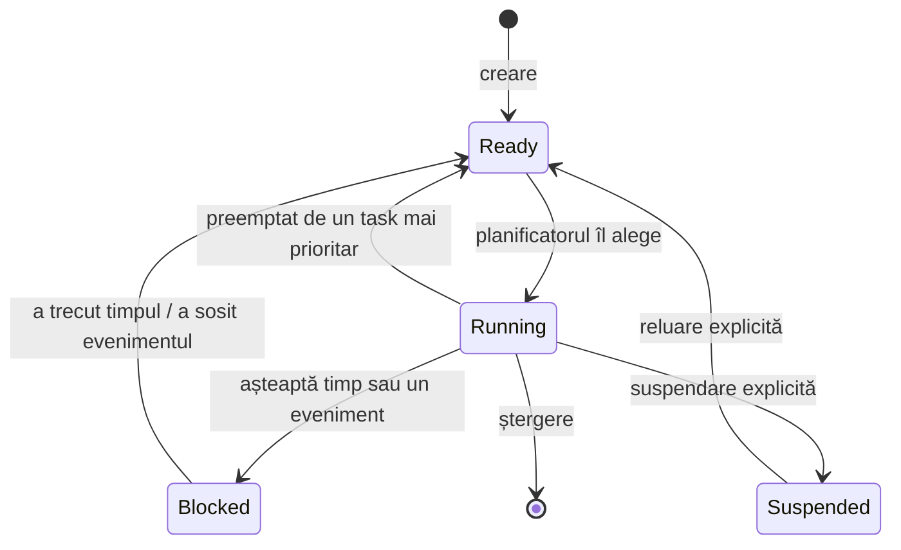

# Taskuri și stări

## 1. Problema

Un program obișnuit face un singur lucru odată, de sus până jos. Un sistem de
timp real are mai multe lucruri de făcut „în același timp”: citește un senzor,
calculează o comandă, scrie un jurnal, răspunde unui operator. Fiecare dintre
ele are ritmul și urgența lui. Dacă le scriem într-o singură buclă, cea mai
lentă activitate le întârzie pe toate celelalte, iar urgența nu poate fi
exprimată nicăieri.

Pe un procesor cu un singur nucleu rulează, în orice clipă, exact o bucată de
cod. „În același timp” este deci o iluzie care trebuie construită: cineva
trebuie să hotărască, moment de moment, cine primește procesorul.

## 2. Ideea

Programul se împarte în **taskuri**, iar un **planificator** (scheduler), parte
a sistemului de operare de timp real, alege în fiecare moment taskul care
rulează. Fiecare task este scris ca și cum ar avea procesorul doar pentru el.
Planificatorul îl poate opri în orice punct și îl poate relua mai târziu exact
de acolo, fără ca taskul să observe altceva decât că timpul a trecut.

Din punctul de vedere al planificatorului, un task se află mereu într-una din
câteva **stări**:

Diferența esențială este între Ready și Blocked. Un task **Ready** vrea
procesorul și nu îl primește: el *întârzie*. Un task **Blocked** nu vrea
procesorul: nu costă nimic și nu întârzie pe nimeni. Toată analiza de timp real
se ocupă, în fond, de cât timp petrece un task în starea Ready.

## 3. Teorie

**Task** (task, numit și fir de execuție): o activitate secvențială cu trei
lucruri proprii: o **stivă** (stack) pentru variabilele locale și adresele de
întoarcere, o **prioritate** și o **stare**. Taskurile împart memoria globală
și perifericele; de aici vin problemele din
[Condiții de cursă](../5-shared-resources/race-conditions.md).

**Stările unui task**:

| Stare | În română | Înseamnă |
|---|---|---|
| Running | în execuție | are procesorul; pe un singur nucleu, un singur task odată |
| Ready | gata | ar putea rula, dar procesorul este la un task cel puțin la fel de prioritar |
| Blocked | blocat | așteaptă trecerea unui timp sau un eveniment (un semafor, un mesaj, o notificare) |
| Suspended | suspendat | scos din planificare până când alt task îl reia explicit |

Taskurile Ready stau într-o **coadă de taskuri gata** (ready queue), ordonată
după prioritate. Planificatorul îl alege mereu pe primul.

**Comutare de context** (context switch): salvarea registrelor procesorului
pentru taskul oprit și încărcarea celor ale taskului care urmează. Proprietăți:

- este invizibilă pentru task, dar nu gratuită: durează, de exemplu, câteva
  microsecunde până la câteva zeci, în funcție de procesor;
- costul ei se plătește la fiecare preempțiune, deci un sistem care comută
  foarte des pierde timp de procesor fără să facă muncă utilă;
- în analiză este de obicei neglijată sau inclusă în timpul de calcul al
  taskurilor, ceea ce este corect doar dacă rămâne mică față de acesta.

**Momentele în care planificatorul decide**: când un task se blochează, când
un task devine Ready (a expirat o așteptare, a sosit un eveniment, o
întrerupere a trezit un task) și la fiecare **tick**, întreruperea periodică de
ceas a sistemului de operare, de exemplu o dată pe milisecundă. Între aceste
momente taskul curent rulează nestingherit.

**Taskul idle** (idle task): un task cu prioritatea cea mai mică, mereu Ready,
care rulează când niciun alt task nu poate rula. Datorită lui planificatorul
are întotdeauna ce alege. Timpul petrecut în taskul idle este exact timpul
liber al procesorului, deci o măsură directă a încărcării. Pe lângă taskurile
aplicației, un sistem de operare de timp real rulează și taskuri proprii:
taskul idle, un task de serviciu pentru temporizatoare, taskuri ale
driverelor. Și ele concurează pentru procesor, după aceleași reguli.

**Un singur procesor.** Toate taskurile concurează pentru aceeași resursă.
Timpul primit de un task este timp luat celorlalte, deci întârzierea unui task
se poate calcula din ceea ce fac taskurile mai prioritare. Pe mai multe nuclee
acest calcul devine mult mai greu.

## 4. Exemplu

Trei taskuri pe un procesor, urmărite într-un moment oarecare:

| Task | Prioritate | Ce face în acel moment | Stare |
|---|---|---|---|
| comandă | mare | așteaptă următoarea perioadă, peste 3 ms | Blocked |
| filtrare | medie | calculează | Running |
| jurnal | mică | are date de scris | Ready |
| idle | cea mai mică | nimic | Ready |

Taskul de jurnal este Ready, nu Blocked: nu așteaptă niciun eveniment, așteaptă
doar procesorul, și va întârzia atât cât calculează filtrarea. Peste 3 ms
expiră așteptarea taskului de comandă. El devine Ready, are prioritatea cea mai
mare, deci planificatorul face o comutare de context: filtrarea trece din
Running în Ready, în mijlocul calculului, iar comanda trece în Running. Când
comanda termină și se blochează din nou, filtrarea continuă exact de unde a
rămas. Jurnalul rulează abia când ambele sunt blocate.

Costul comutărilor, calculat: dacă o comutare durează, de exemplu, 10 µs și
taskul de comandă rulează de 1000 de ori pe secundă, fiecare rulare aduce două
comutări, deci $2 \cdot 1000 \cdot 10\ \mu s = 20$ ms pe secundă, adică 2 % din
procesor, consumate doar pentru comutare.

## 5. Greșeli frecvente

- **„Un task blocat consumă procesor.”** Nu. Doar taskurile Running consumă.
  Un sistem cu o sută de taskuri blocate este la fel de liber ca unul fără
  niciun task.
- **„Ready înseamnă că rulează.”** Ready înseamnă că *ar putea* rula. Timpul
  petrecut în Ready este întârziere pură și este exact ceea ce trebuie mărginit
  într-un sistem de timp real.
- **„Taskurile rulează în paralel.”** Pe un singur nucleu rulează intercalat.
  Paralelismul este doar aparent, dar problemele de acces la date comune sunt
  reale.

## 6. Întrebări de verificare

1. Un task cu prioritate mică rămâne mult timp în starea Ready. Ce spune
   aceasta despre încărcarea sistemului? Dar dacă rămâne mult timp în Blocked?
2. De ce are nevoie fiecare task de o stivă proprie? Ce s-ar întâmpla la o
   comutare de context dacă două taskuri ar împărți aceeași stivă?
3. Procesorul petrece 30 % din timp în taskul idle. Se poate adăuga un task nou
   care cere 20 % din procesor? Ce altceva trebuie verificat în afară de
   această sumă?
4. De ce se neglijează de obicei costul comutării de context în analiză și
   când încetează această aproximare să fie acceptabilă?

Pentru mai mult: G. Buttazzo, *Hard Real-Time Computing Systems*, cap. 2;
A. Burns, A. Wellings, *Real-Time Systems and Programming Languages*, cap. 4;
R. Barry, *Mastering the FreeRTOS Real Time Kernel*, cap. „Task Management”.

Laborator asociat: [Lab 2](../../lab2-scheduling/README.md).
